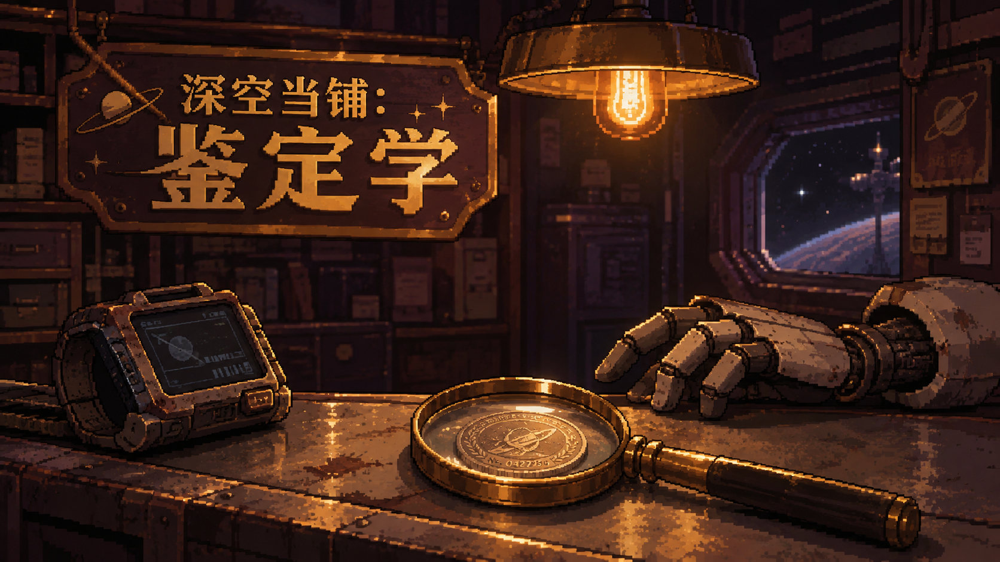

# Probably Stolen: Appraisal Studies / 深空当铺：鉴定学

> 《深空当铺 / Probably Stolen》的鉴定向模组：新增鉴定品、纸质手册，并把原版的晋升改为「电话约考」。
> 前瞻版 0.6.1 · 需要游戏版本 **0.46D**



---

## 这是什么

原版的鉴定部分只有三件物品、三条晋升线。这个模组往鉴定行当里添了四件新货、四本纸质手册、一张行会名片，并把「晋升进度满了委员会自动上门」改成「你必须自己打电话预约考试」。

| 内容 | 说明 |
|---|---|
| 四件鉴定品 | 仿生指节 / 个人环境检测仪 / 腕式通讯终端 / 第九环港开港纪念币 |
| 四本手册 | 每件一本，入会与晋级时发到柜台，可翻查差分与报价规则 |
| 行会名片 | 双击打开，卡面印预约号 1717 |
| 电话约考 | 晋升进度满 100% 才能预约；考官次日到店，三件里估准两件即通过 |
| 晋升考核 | 考试期间不计鉴定费，考后缴 150¢，缴费且合格才发证 |

#### 四件鉴定品

| 物品 | 差分 | 报价区间 |
|---|---|---|
| 仿生指节 | 材质 3 × 品相 3 × 接口刻字 3 = 27 种 | 35–170¢ |
| 个人环境检测仪 | 传感器 3 × 机身 3 × 插件 4 × 厂商 3 = 108 种 | 40–250¢ |
| 腕式通讯终端 | 品相 3 × 材质 2 × 服务 4 = 24 种 | 40–620¢ |
| 开港纪念币 | 材质 3 × 版别 3，另有防伪编号与赝品 | 40–960¢ |

与原版一致的部分：放大镜、鉴定公式、估价精度、95–105% 的完美区间都没有改动。

---

## 安装

**方式一（推荐）**：Steam 创意工坊订阅 →
[工坊物品页](https://steamcommunity.com/sharedfiles/filedetails/?id=3843013479)

**方式二**：把发布包里的文件夹整个放进

```
<游戏目录>\Mods\AppraisalExpansion\
```

然后在游戏的「模组」菜单里启用，按提示重启。

---

## 从源码构建

需要 .NET SDK（仓库脚本用 `csc.dll` 直接编译，不依赖 Unity）与游戏本体。

```powershell
# 编译（默认游戏路径写死在脚本参数里，可用 -GameDir 指定）
.\mod\AppraisalExpansion\scripts\build.ps1 -GameDir "D:\SteamLibrary\steamapps\common\Probably Stolen"

# 部署到 Mods 目录（游戏必须完全退出）
.\mod\AppraisalExpansion\scripts\deploy.ps1 -GameDir "D:\SteamLibrary\steamapps\common\Probably Stolen"
```

发布包（`dist/`）由脚本从「已部署的那一份」生成，保证与实测版本一致：

```powershell
.\tools\make_dist.ps1
```

> 若脚本报「字符串缺少终止符」，是 PowerShell 5.1 读无 BOM 的 UTF-8 脚本导致的老问题——本仓库脚本已带 BOM。

---

## 目录结构

```
mod/AppraisalExpansion/
  manifest.xml            模组清单（版本号唯一真源）
  src/                    源码（C#，Harmony 补丁 + 数据）
  Books/                  五本纸质手册 / 名片的 JSON 版面
  Localization/           en / zh / zh-Hans 文案表
  assets/                 美术源文件与生成脚本的输入
  scripts/                build.ps1 / deploy.ps1
assets/                   物品、图标的源画
tools/                    手册生成、素材处理、审计脚本
```

---

## 反馈

问题与建议请提交到 Issues；也可以在创意工坊评论区留言。

---

## 路线图

- 0.6.x：初级档四件（当前）
- 后续：初级档补满 8 件 → 发布 1.0
- 长期：每个鉴定等级 8 件，共 32 件

---

## 致谢与署名

- 美术 / Art — **jianyunotqiangyu**（剑鱼不是枪鱼）
- 程序 / Programming — **阿鉴**（jy 的 DS 助手）
- 手册与文案由 DeepSeek 协助撰写；鉴定基图使用 Retro Diffusion Pro 生成，全部差分由作者手绘

---

## 许可证

| 内容 | 许可证 |
|---|---|
| 代码（`src/`、`scripts/`、`tools/`） | [MIT](LICENSE) |
| 美术与文案（`assets/`、`Books/`、`Localization/`、手册内容） | [CC BY-NC-SA 4.0](LICENSE-ASSETS) |

游戏本体与其素材版权归 Questing Goose Studio 所有；本仓库不包含任何游戏原生资源。
